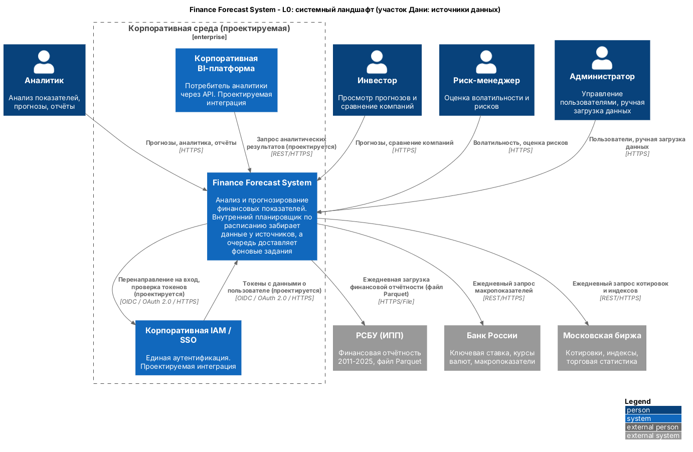
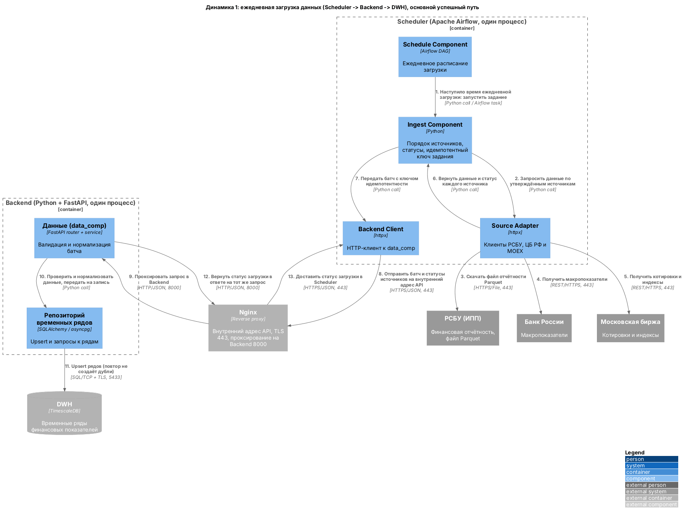
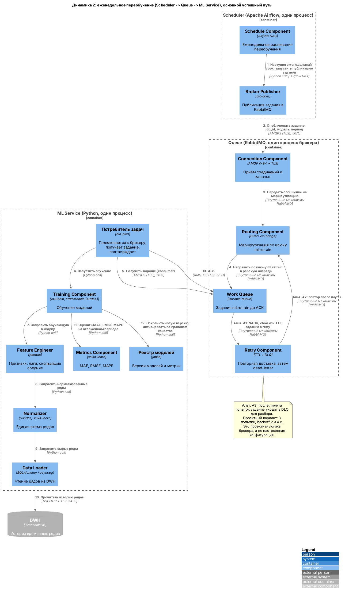
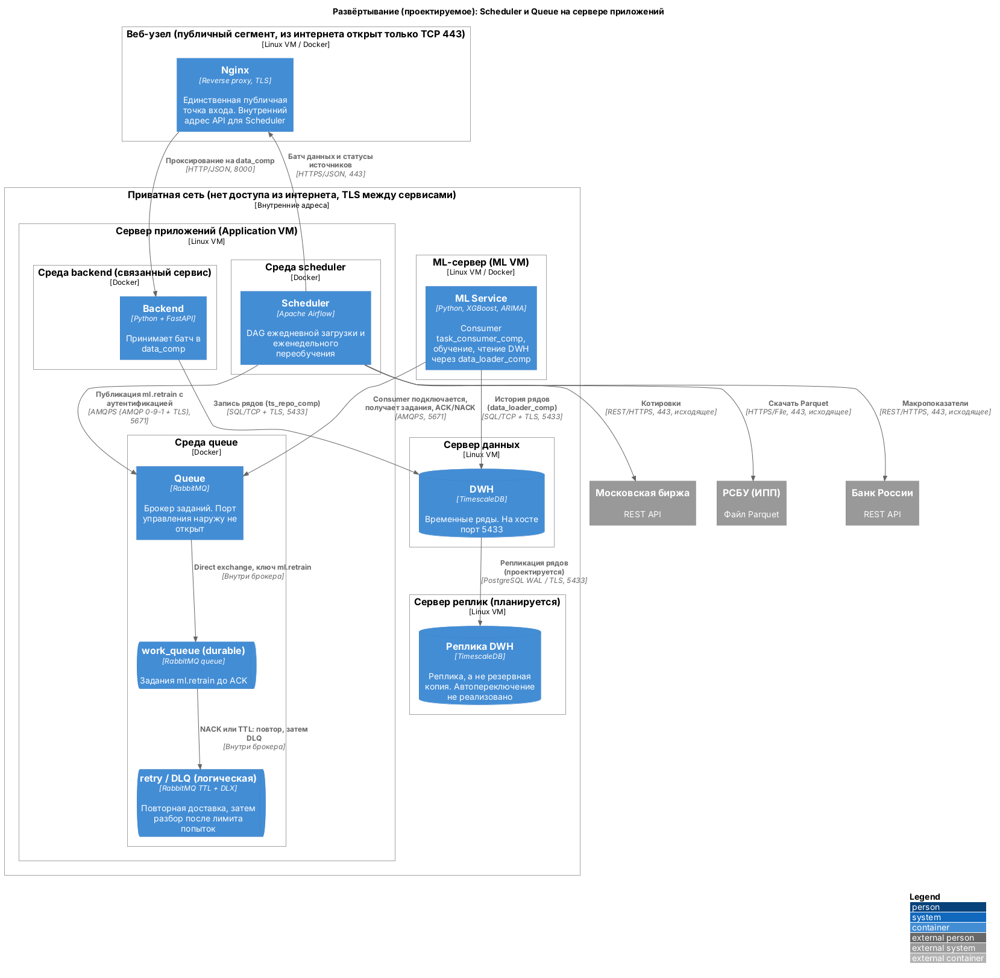

# ЛР №4. Даня: scheduler (Airflow) и queue (RabbitMQ)

Зона ответственности: планирование фоновых заданий и их доставка через RabbitMQ.
Планировщик не обучает модель, очередь сама не загружает финансовые файлы.

Это архитектурное проектирование. Всё, что связано с IAM/BI, виртуальными машинами,
портами, TLS, репликами и Airflow, описано как **планируемое**, а не как уже развёрнутое
и проверенное на сервере.

## Цель

Показать для участка «планировщик и брокер» четыре вещи:

1. L0: где Finance Forecast System стоит среди внешних источников и корпоративных систем.
2. Динамика 1: ежедневная загрузка данных (Scheduler -> Backend -> DWH).
3. Динамика 2: еженедельное переобучение (Scheduler -> Queue -> ML Service).
4. Deployment: на каких узлах работают Scheduler и Queue и какие порты и сети им нужны.

## L0: системы и связи



Finance Forecast System (`finance_system`) показана как **одна** система внутри
корпоративной границы вместе с `corp_iam` и `corp_bi`. Снаружи границы находятся три
источника данных и четыре категории пользователей. Scheduler и RabbitMQ на L0 не
показаны: они внутри `finance_system`.

Вклад моего участка: именно Scheduler по расписанию забирает данные у трёх источников,
а Queue доставляет фоновые задания переобучения. На L0 это видно только по связям
системы с источниками.

| Откуда | Куда | Что передаётся | Протокол |
|---|---|---|---|
| analyst, investor, risk_manager, admin | finance_system | Запросы прогнозов, аналитики, управление данными | HTTPS |
| finance_system | rfsd_dataset | Ежедневная загрузка финансовой отчётности (файл Parquet) | HTTPS/File |
| finance_system | cbr_api | Ежедневный запрос макропоказателей | REST/HTTPS |
| finance_system | moex_api | Ежедневный запрос котировок и индексов | REST/HTTPS |
| finance_system | corp_iam | Перенаправление на вход, проверка токенов (проектируется) | OIDC / OAuth 2.0 / HTTPS |
| corp_iam | finance_system | Токены с данными о пользователе (проектируется) | OIDC / OAuth 2.0 / HTTPS |
| corp_bi | finance_system | Запрос аналитических результатов (проектируется) | REST/HTTPS |

Порт для всех этих связей 443. К `db_main` и `dwh` BI напрямую не подключается.

## Dynamic: пошаговый сценарий

Ежедневная загрузка и еженедельное переобучение показаны в **двух самостоятельных**
диаграммах. Переобучение не является продолжением каждого ежедневного импорта.
Компоненты взяты из L3 (`src/l3-components`).

### Динамика 1: ежедневная загрузка данных



Основной путь: все три источника отвечают, Backend доступен.

| № | Откуда | Куда | Что передаётся | Протокол / порт |
|---|---|---|---|---|
| 1 | schedule_comp | ingest_comp | Наступило время ежедневной загрузки, запуск задания | Python call / Airflow task |
| 2 | ingest_comp | source_adapter_comp | Запрос данных по утверждённым источникам | Python call |
| 3 | source_adapter_comp | rfsd_dataset | Скачивание файла отчётности Parquet | HTTPS/File, 443 |
| 4 | source_adapter_comp | cbr_api | Макропоказатели | REST/HTTPS, 443 |
| 5 | source_adapter_comp | moex_api | Котировки и индексы | REST/HTTPS, 443 |
| 6 | source_adapter_comp | ingest_comp | Данные и статус каждого источника | Python call |
| 7 | ingest_comp | backend_client_comp | Батч с ключом идемпотентности | Python call |
| 8 | backend_client_comp | Nginx | Батч и статусы источников на внутренний адрес API | HTTPS/JSON, 443 |
| 9 | Nginx | data_comp (backend) | Тот же запрос, проксированный в Backend | HTTP/JSON, 8000 |
| 10 | data_comp | ts_repo_comp | Проверенные и нормализованные данные для записи | Python call |
| 11 | ts_repo_comp | dwh | Upsert финансовых рядов | SQL/TCP + TLS, 5433 |
| 12 | data_comp | Nginx | Статус загрузки в ответе на тот же запрос | HTTP/JSON, 8000 |
| 13 | Nginx | backend_client_comp | Статус загрузки в Scheduler | HTTPS/JSON, 443 |

Нумерация подробнее, чем в исходном перечне, потому что Nginx показан отдельным шагом:
по сетевой спецификации Scheduler обращается к Backend только через него (443 снаружи,
8000 внутри). Шаги 12-13 — это «статус загрузки: backend -> scheduler» как ответ на тот
же запрос. Внутри процессов (шаги 1, 2, 6, 7, 10) вызовы Python, а не HTTPS.

**Альтернативы (описаны текстом, на схеме не показаны).**

- *Частичный отказ источника.* Если один из трёх источников не ответил, `ingest_comp`
  фиксирует его статус как ошибку, а данные остальных источников всё равно передаёт
  дальше. В Backend идёт батч с итоговым статусом «частично успешно» и списком
  источников с ошибкой. Для сбойного источника предусмотрен повтор задачи средствами
  Airflow, а не «тихая» потеря данных.
- *Идемпотентность.* Каждое задание получает ключ идемпотентности (например, дата
  загрузки и источник). Повторный запуск того же задания даёт тот же результат: запись
  в DWH выполняется как upsert, а не как вставка, поэтому повторная загрузка не создаёт
  дубли. Ключ ряда определяется схемой DWH (зона Игоря); с ним это нужно согласовать.
- *Дубли недопустимы.* Двойной запуск DAG и повторная доставка запроса при обрыве связи
  не должны менять данные при втором проходе.
- *Backend недоступен.* Запрос на шаге 8 завершается ошибкой, Scheduler помечает
  задание неуспешным и повторяет его по правилам Airflow; данные в DWH не меняются.
- *Кто что делает.* Scheduler **не очищает** датасет: валидация и нормализация
  относятся к `data_comp` (шаг 10), как зафиксировано в L3.

### Динамика 2: еженедельное переобучение



Основной путь: задание получено и модель обучена успешно.

| № | Откуда | Куда | Что передаётся | Протокол / порт |
|---|---|---|---|---|
| 1 | schedule_comp | broker_publisher_comp | Наступил еженедельный срок, запуск публикации | Python call / Airflow task |
| 2 | broker_publisher_comp | connection_comp (queue) | Задание: job_id, модель и период | AMQPS (TLS), 5671 |
| 3 | connection_comp | routing_comp | Сообщение на маршрутизацию | Внутренние механизмы RabbitMQ |
| 4 | routing_comp | work_queue_comp | Направление по ключу `ml.retrain` (direct exchange) | Внутренние механизмы RabbitMQ |
| 5 | task_consumer_comp (ml_service) | work_queue_comp | Consumer сам подключается к брокеру и получает задание | AMQPS (TLS), 5671 |
| 6 | task_consumer_comp | training_comp | Запуск обучения | Python call |
| 7 | training_comp | feature_engineer_comp | Запрос обучающей выборки | Python call |
| 8 | feature_engineer_comp | normalizer_comp | Запрос нормализованных рядов | Python call |
| 9 | normalizer_comp | data_loader_comp | Запрос сырых рядов | Python call |
| 10 | data_loader_comp | dwh | Чтение истории рядов | SQL/TCP + TLS, 5433 |
| 11 | training_comp | metrics_comp | Оценка MAE, RMSE, MAPE на отложенном временном периоде | Python call |
| 12 | training_comp | model_registry_comp | Сохранение новой версии; активация по правилам качества | Python call |
| 13 | task_consumer_comp | work_queue_comp | ACK после успешной обработки | AMQPS (TLS), 5671 |

Цепочка шагов 7-10 повторяет L3 ML Service (`training` -> `feature_engineer` ->
`normalizer` -> `data_loader` -> `dwh`); в исходном перечне она записана одной строкой.

Важные моменты:

- **RabbitMQ не HTTP-сервер.** Брокер не «вызывает» ML Service. `task_consumer_comp`
  сам открывает AMQPS-соединение и получает сообщения. Поэтому на схеме стрелка 5
  идёт от consumer к брокеру.
- **Шаги 3-4** — внутренние механизмы RabbitMQ (обменник, очередь), а не сетевой
  протокол и не вызов Python.
- **ACK (шаг 13)** отправляется только после успешного обучения и сохранения версии.
  Пока ACK нет, задание остаётся в очереди.
- **Новая версия модели** активируется только по правилам качества (шаг 12). Если
  метрики хуже действующей версии, активная модель не меняется.

**Отказ и повтор (проектная логика брокера).**

| Ветка | Что происходит |
|---|---|
| A1 | NACK, сбой потребителя или истечение TTL: задание уходит из `work_queue_comp` в `retry_comp` |
| A2 | После паузы TTL `retry_comp` возвращает задание в `routing_comp`, и оно снова попадает в рабочую очередь |
| A3 | После лимита попыток задание отправляется в DLQ для разбора; основная очередь не блокируется |

Проектный вариант параметров: 3 попытки, backoff 2 и 4 секунды. Это проектная логика
брокера, которая в RabbitMQ пока **не настроена**. Python-прототип из ЛР №3
(`src/l4-code/danya-retry`, стратегии FixedDelay и ExponentialBackoff, in-memory DLQ) —
учебная модель этой логики, а не рабочая интеграция с брокером.

## Deployment: узлы и безопасность



Узлы (все проектируемые, Linux VM + Docker):

| Узел | Что размещается | Доступ |
|---|---|---|
| Веб-узел | Nginx | Единственная публичная точка входа, TCP 443 |
| Application VM | Контейнеры backend, scheduler (Airflow), queue (RabbitMQ) в разных Docker-средах | Приватная сеть |
| ML VM | ml_service (внутри consumer `task_consumer_comp`) | Приватная сеть |
| Сервер данных | dwh (TimescaleDB) | Приватная сеть |
| Сервер реплик (планируется) | Реплика dwh | Приватная сеть |

Сетевые связи моего участка:

| Откуда | Куда | Что передаётся | Протокол / порт |
|---|---|---|---|
| scheduler | rfsd_dataset | Файл Parquet (исходящее соединение) | HTTPS/File, 443 |
| scheduler | cbr_api | Макропоказатели (исходящее) | REST/HTTPS, 443 |
| scheduler | moex_api | Котировки (исходящее) | REST/HTTPS, 443 |
| scheduler | Nginx | Батч данных и статусы источников | HTTPS/JSON, 443 |
| Nginx | backend (data_comp) | Проксированный запрос | HTTP/JSON, 8000 |
| backend | dwh | Запись рядов через ts_repo_comp | SQL/TCP + TLS, 5433 |
| scheduler | queue | Публикация задания `ml.retrain` с аутентификацией | AMQPS (AMQP 0-9-1 + TLS), 5671 |
| ml_service | queue | Consumer подключается, получает задания, шлёт ACK/NACK | AMQPS, 5671 |
| queue | work_queue, retry / DLQ | Direct exchange и повтор | Внутри брокера |
| ml_service | dwh | История рядов через data_loader_comp | SQL/TCP + TLS, 5433 |
| dwh | реплика dwh | Репликация (проектируется) | PostgreSQL WAL / TLS, 5433 |

Безопасность и отказоустойчивость (планируется):

- Из интернета открыт только TCP 443 на Nginx. Порт 8000 доступен только во внутренней
  сети, клиентам он недоступен.
- Порт управления RabbitMQ в интернет не публикуется. Публикация и получение заданий
  идут только по AMQPS на 5671 с аутентификацией.
- Scheduler не принимает внешних подключений; он только исходящий клиент: к источникам,
  к Nginx и к RabbitMQ. Веб-интерфейс Airflow, если он используется, не выносится в
  интернет.
- **RabbitMQ не обращается к DWH.** ML Service читает данные для обучения сам, через
  `data_loader_comp`, а брокер передаёт только задание.
- В `queue` показаны durable `work_queue` и логическая retry/DLQ.
- Реплика DWH **не является резервной копией**; автоматическое переключение на неё не
  считается реализованным.
- Если Airflow использует внутреннюю мета-БД, её **нельзя смешивать с `db_main`**
  (основной бизнес-БД). Для этой ЛР мета-БД Airflow оставлена вне упрощённой схемы.

## Что проектируется, а что уже описано в L1–L3

| Тема | Уже описано в L1–L3 | Проектируется в ЛР №4 |
|---|---|---|
| Планировщик | L2/L3: контейнер scheduler, 5 компонентов; вариант «Airflow / Celery Beat» | Выбран Airflow; Celery Beat не используется |
| Очередь | L3: connection_comp, routing_comp, work_queue_comp, retry_comp; протокол «AMQP» | AMQPS с TLS на порту 5671, аутентификация publisher |
| Загрузка данных | L3: источники -> source_adapter_comp -> backend_client_comp -> data_comp | Шаг через Nginx (443 -> 8000), идемпотентность, частичный отказ |
| Переобучение | L3: scheduler -> queue -> ml_service | Consumer сам подключается к брокеру; ACK/NACK, TTL, DLQ |
| Повторы | L4 (ЛР №3): Python-прототип со стратегиями, 26 тестов | Проектный вариант для брокера: 3 попытки, backoff 2 и 4 с |
| IAM и BI | Не было | corp_iam и corp_bi как проектируемые интеграции |
| Узлы и сети | Не было | Nginx, Application VM, ML VM, серверы данных и реплик, приватная сеть |
| Реплики | Не было | Реплика dwh (проектируется), не резервная копия |

Ничего из колонки «Проектируется» не развёрнуто и не проверено на сервере.

## Как проверить рендер

C4-PlantUML подключается по ссылке на GitHub, поэтому нужен доступ в интернет.

```bash
# синтаксис и отрисовка PNG (PlantUML + Graphviz)
java -jar plantuml.jar -checkonly src/lab4/danya/*.puml
java -jar plantuml.jar -tpng -o ../../../docs/images/lab4 src/lab4/danya/*.puml
```

Файлы PNG в `docs/images/lab4/` названы `danya-*.png`. Те же проверки выполняет CI
(`.github/workflows/render-docs.yml`): запрещает `Rel_D/R/L/U` и рендерит все `.puml`.

В файлах только `Rel(...)`, нет `skinparam`, каждый файл самостоятелен.

## Список исходных файлов

| Файл | Содержание |
|---|---|
| `src/lab4/danya/landscape_danya.puml` | L0, системный ландшафт |
| `src/lab4/danya/dynamic_danya_ingestion.puml` | Динамика 1: ежедневная загрузка |
| `src/lab4/danya/dynamic_danya_retraining.puml` | Динамика 2: еженедельное переобучение |
| `src/lab4/danya/deployment_danya.puml` | Локальное развёртывание Scheduler и Queue |
| `src/lab4/danya/README.md` | Это описание |
| `docs/images/lab4/danya-landscape.png` | Изображение L0 |
| `docs/images/lab4/danya-dynamic-ingestion.png` | Изображение динамики 1 |
| `docs/images/lab4/danya-dynamic-retraining.png` | Изображение динамики 2 |
| `docs/images/lab4/danya-deployment.png` | Изображение развёртывания |
