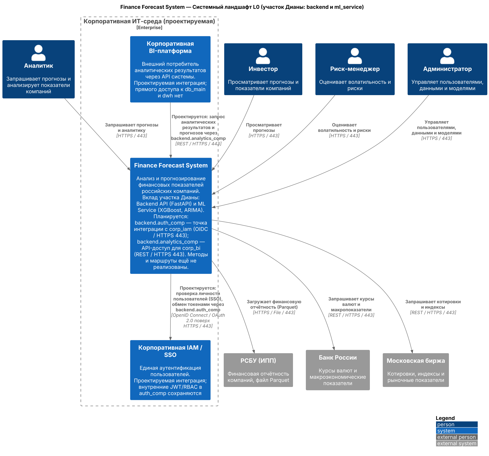
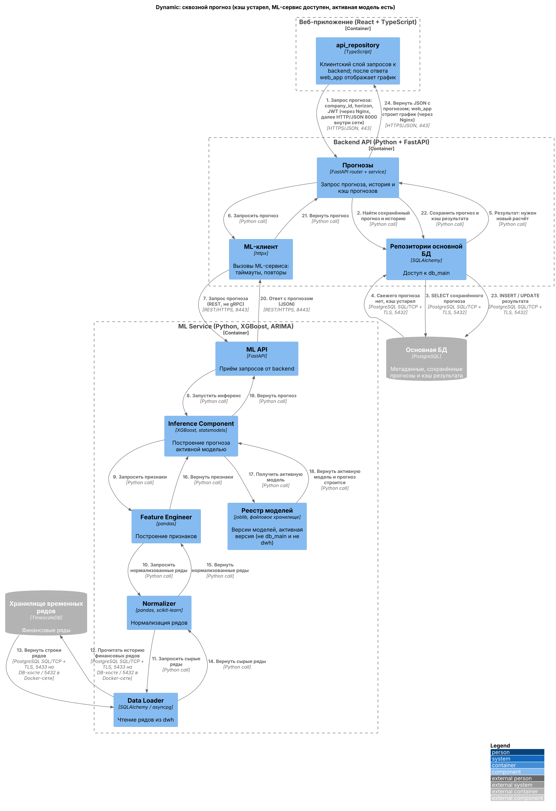
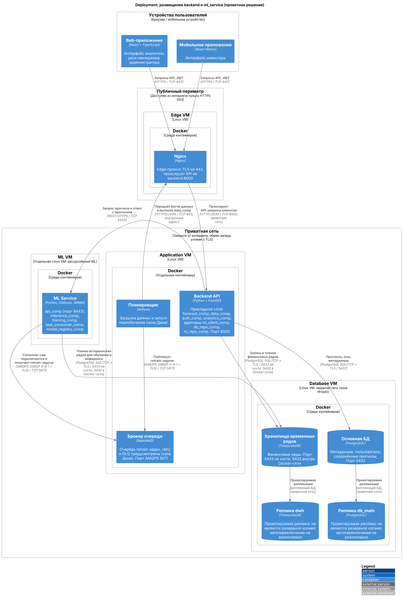

# ЛР №4 — Диана: backend и ml_service

## Цель

Спроектировать для зоны backend (FastAPI) и ml_service (XGBoost, ARIMA): системный ландшафт L0, динамику сквозного прогноза и локальный сегмент развертывания. Это архитектурное проектирование: IAM/BI, виртуальные машины, порты, TLS, реплики, Airflow и RabbitMQ — **утверждённые проектные решения**, а не подтверждённая рабочая инфраструктура. Везде, где речь о них, — «планируется», «предусмотрено».

В новых файлах используется ID `backend` (не `api_backend` из старых работ).

## L0: системы и связи

`finance_system` — один System внутри `Enterprise_Boundary` рядом с `corp_iam` и `corp_bi`. Вне границы: четыре роли (`analyst`, `investor`, `risk_manager`, `admin`) и три источника (`rfsd_dataset`, `cbr_api`, `moex_api`). Других внешних систем нет.

Вклад участка: `backend.auth_comp` — планируемая точка интеграции с `corp_iam` (OIDC / HTTPS 443; внутренние JWT/RBAC остаются); `backend.analytics_comp` — планируемый API-доступ для `corp_bi` (REST / HTTPS 443, без прямого доступа к `db_main`/`dwh`). Методы и маршруты ещё не реализованы. `backend` и `ml_service` на L0 не раскрываются.

## Dynamic: пошаговый сценарий

Основной путь: пользовательский кэш устарел, ML-сервис доступен, активная обученная модель существует. Nginx на диаграмме не рисуется: шаги 1 и 24 идут через него (HTTPS 443 снаружи, HTTP/JSON 8000 внутри сети).

| № | Откуда → Куда | Что передаётся | Протокол/порт |
|---|---|---|---|
| 1 | web_app.api_repository → forecast_comp | company_id, horizon, JWT | HTTPS/JSON, 443 (через Nginx) |
| 2 | forecast_comp → db_repo_comp | поиск сохранённого прогноза/истории | Python call |
| 3–4 | db_repo_comp ⇄ db_main | запрос; ответ «свежего нет» | SQL/TCP + TLS, 5432 |
| 5 | db_repo_comp → forecast_comp | нужен новый расчёт | Python call |
| 6 | forecast_comp → ml_client_comp | запрос прогноза | Python call |
| 7 | ml_client_comp → ml_service.api_comp | запрос прогноза | REST/HTTPS, 8443 |
| 8 | api_comp → inference_comp | запуск инференса | Python call |
| 9–11 | inference → feature_engineer → normalizer → data_loader | запрос признаков/рядов | Python call |
| 12 | data_loader_comp → dwh | чтение истории рядов | SQL/TCP + TLS, 5433 на DB-хосте / 5432 в Docker-сети |
| 13 | dwh → data_loader_comp | строки рядов | то же |
| 14–16 | data_loader → normalizer → feature_engineer → inference | сырые ряды, нормализованные ряды, признаки | Python call |
| 17–18 | inference_comp ⇄ model_registry_comp | запрос и выдача активной модели | Python call |
| 19 | inference_comp → api_comp | прогноз | Python call |
| 20 | api_comp → ml_client_comp | JSON с прогнозом | REST/HTTPS, 8443 |
| 21 | ml_client_comp → forecast_comp | прогноз | Python call |
| 22 | forecast_comp → db_repo_comp | сохранение прогноза/кэша | Python call |
| 23 | db_repo_comp → db_main | INSERT/UPDATE результата | SQL/TCP + TLS, 5432 |
| 24 | forecast_comp → web_app.api_repository | JSON с прогнозом; web_app строит график (детализирует Катя) | HTTPS/JSON, 443 (через Nginx) |

`forecast_comp` не обращается к `db_main`/`dwh` напрямую — только через `db_repo_comp`, `ml_client_comp`, `ts_repo_comp`. `model_registry_comp` хранит версии моделей (файловое хранилище ML-узла); `db_main` — метаданные и сохранённые прогнозы, `dwh` — финансовые ряды.

### Альтернативы (вне основного пути)

- **Свежий сохранённый прогноз.** На шагах 3–5 `db_main` возвращает актуальный результат → `forecast_comp` сразу отвечает клиентом (шаг 24), ML не вызывается.
- **ML недоступен.** `ml_client_comp` получает таймаут/ошибку → `CachedForecastStrategy` / `FallbackForecastStrategy` возвращают последний доступный сохранённый прогноз, если он есть; иначе возвращается ошибка. Это не подмена валидного запроса. Стратегии L4 — учебные, в сетевое приложение не интегрированы.

### Дополнительный сценарий: переобучение (отдельные триггеры, не продолжение сценария выше)

1. Ежедневная загрузка: `scheduler` → Nginx → `backend.data_comp` (HTTPS/JSON 443, затем 8000), `data_comp` → `ts_repo_comp` → `dwh` (SQL/TCP + TLS; запись идемпотентна).
2. Еженедельное переобучение (свой cron): `scheduler` публикует retrain-задачу в `queue` (AMQPS 5671). `ml_service.task_consumer_comp` сам подключается к брокеру (AMQPS 5671) и получает задачу → `training_comp` → читает `dwh` через `data_loader_comp` → `metrics_comp` оценивает MAE/RMSE/MAPE → `model_registry_comp` сохраняет версию (активной — если не хуже текущей). После успеха — ACK; при неуспехе предусмотрены retry и DLQ.

## Deployment: узлы и безопасность

Проектируемое размещение: Edge VM (Nginx), Application VM (отдельные Docker-контейнеры backend, Airflow, RabbitMQ), отдельная ML VM (ml_service; вынесена из-за ресурсоёмкости ML), Database VM (db_main, dwh — зона Игоря) в закрытой сети. Из интернета доступен только HTTPS 443 на Nginx; клиенту порт 8000 недоступен. Реплики `db_main` и `dwh` проектируются, не являются резервными копиями, автопереключение не реализовано; у RabbitMQ предусмотрены retry/DLQ. Наличие VM, Docker и маршрутов не утверждается.

## Таблица интерфейсов

| Откуда → Куда | Что передаётся | Протокол/порт |
|---|---|---|
| Пользователь / web_app / mobile_app → Nginx | запросы API, JWT | HTTPS / TCP 443 |
| Nginx → backend | проксированные API-запросы | HTTP/JSON / TCP 8000 (приватная сеть) |
| scheduler → Nginx → backend.data_comp | батчи загруженных данных | HTTPS/JSON / TCP 443 → 8000 |
| backend → ml_service | запрос прогноза; ответ | REST/HTTPS / TCP 8443 |
| backend → db_main | сохранённые прогнозы, кэш, метаданные | PostgreSQL SQL/TCP + TLS / 5432 |
| backend, ml_service → dwh | финансовые ряды | SQL/TCP + TLS / 5433 на хосте (5432 в Docker-сети) |
| scheduler → queue | retrain-задачи (publisher) | AMQPS (AMQP 0-9-1 + TLS) / TCP 5671 |
| ml_service → queue | подключение consumer, получение retrain-задач, ACK | AMQPS / TCP 5671 |
| scheduler → rfsd_dataset | отчётность РСБУ, Parquet | HTTPS/File / 443 |
| scheduler → cbr_api / moex_api | макро- и рыночные данные | REST/HTTPS / 443 |
| finance_system ↔ corp_iam | проектируемый SSO | OIDC / OAuth 2.0 поверх HTTPS / 443 |
| corp_bi → finance_system | проектируемый запрос аналитики | REST/HTTPS / 443 |

## Что проектируется, а что уже описано в L1–L3

Уже описано в L1–L3: контейнеры, компоненты backend и ml_service (`src/l3-components/diana-*.puml`), источники данных. Проектируется в ЛР №4: интеграции с `corp_iam`/`corp_bi`, VM-размещение, порты и TLS, реплики БД, retry/DLQ. Уточнение к L3: там у ml_client указано «REST/gRPC», для ЛР №4 выбран REST/HTTPS 8443. Старые файлы не изменялись.

## Как проверить рендер

Каждый `.puml` самодостаточен (C4-PlantUML подключается по URL, как в остальных работах репозитория). Откройте в PlantUML (VS Code с расширением PlantUML, plantuml.com или `java -jar plantuml.jar -tpng файл.puml`). PNG в `docs/images/lab4/` отрисованы локально; чтобы не зависеть от доступа к GitHub, при рендере использовалась встроенная в PlantUML копия C4 (`!include <C4/C4_Context>` и т. п.).

## Список исходных файлов

- `src/lab4/diana/landscape_diana.puml` → `docs/images/lab4/diana-landscape.png`
- `src/lab4/diana/dynamic_diana_forecast.puml` → `docs/images/lab4/diana-dynamic-forecast.png`
- `src/lab4/diana/deployment_diana.puml` → `docs/images/lab4/diana-deployment.png`
- `src/lab4/diana/README.md`
