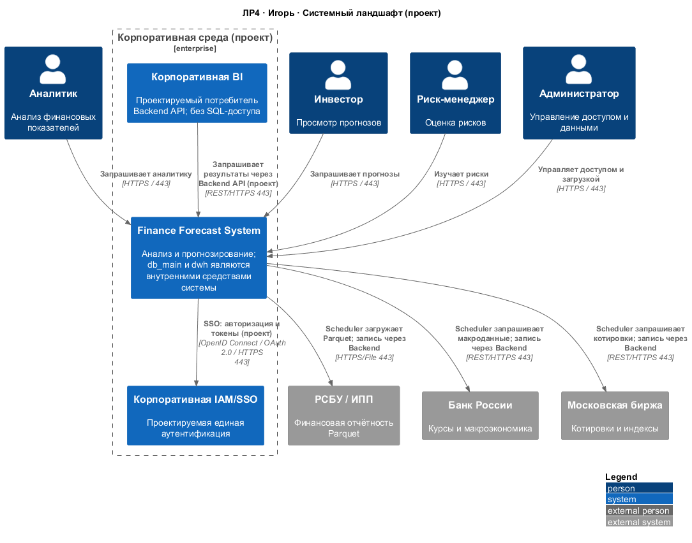
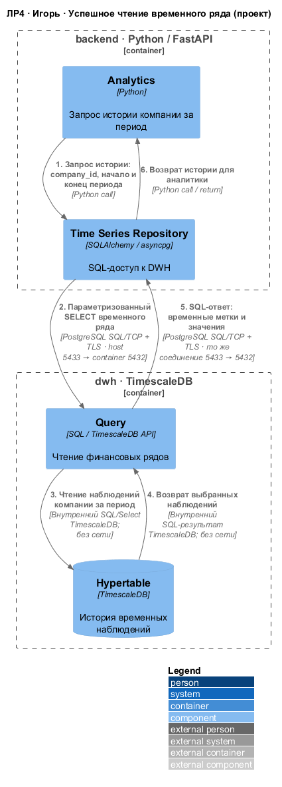
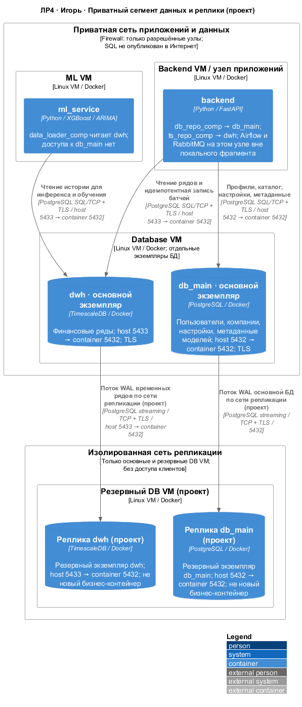

# ЛР4 Колядин Игорь — db_main и dwh

## Цель

Спроектировать системный ландшафт, последовательность чтения финансовых данных и локальную инфраструктуру двух разных контейнеров: **db_main** (PostgreSQL: пользователи, компании, настройки, метаданные моделей) и **dwh** (TimescaleDB: финансовые временные ряды, котировки, макроэкономика). Основание: персональное ТЗ «ТЗ_ЛР4_Игорь.docx», разделы 1–7, и [решения ЛР4](../ARCHITECTURE_DECISIONS.md).

Это проектируемая архитектура. Реальные VM, TLS, репликация, IAM/BI и подключение Python-прототипа L4 к TimescaleDB здесь не развёртываются. Нового прикладного кода нет. Исходная база ветки: origin/main, коммит 1d2c9e9.

## L0: системы и связи



В корпоративной границе находятся одна finance_system и ровно две утверждённые корпоративные системы corp_iam и corp_bi. Четыре персоны analyst, investor, risk_manager, admin и три источника rfsd_dataset, cbr_api, moex_api находятся снаружи. Система обращается к IAM по OpenID Connect / OAuth 2.0 поверх HTTPS; BI получает результаты через Backend API. Базы — внутренние средства finance_system, поэтому не выделены на L0.

Стрелки к источникам показывают инициатора загрузки. Данные возвращаются по установленным HTTPS-соединениям. Внутри системы scheduler получает источники, затем передаёт батч backend.data_comp; прямого подключения источников к DWH нет. Никакого прямого SQL из браузера, смартфона или BI не предусмотрено.

| Откуда | Куда | Что передаётся | Протокол/порт |
|---|---|---|---|
| analyst / investor / risk_manager / admin | finance_system | Запросы аналитики, прогнозов и администрирования | HTTPS / TCP 443 |
| finance_system | corp_iam | Запросы авторизации и токены SSO (проект) | OpenID Connect / OAuth 2.0 / HTTPS 443 |
| corp_bi | finance_system | Запросы аналитического API и результаты | REST/HTTPS 443 |
| finance_system (scheduler) | rfsd_dataset | Запрос и загрузка отчётности Parquet | HTTPS/File 443 |
| finance_system (scheduler) | cbr_api | Запрос и получение макроэкономики | REST/HTTPS 443 |
| finance_system (scheduler) | moex_api | Запрос и получение котировок | REST/HTTPS 443 |

## Dynamic: пошаговый сценарий



Основной успешный путь — backend.analytics_comp получает исходную историю компании за период. Данные существуют, соединение доступно; получение данных выполняется без использования клиентского кэша. Единственная последовательность с непрерывной нумерацией:

1. analytics_comp → ts_repo_comp: company_id и границы периода, Python call.
2. ts_repo_comp → dwh_query_comp: параметризованный SQL-запрос, PostgreSQL SQL/TCP + TLS; порт DB VM 5433 отображается на 5432 контейнера TimescaleDB.
3. dwh_query_comp → dwh_hypertable_comp: внутреннее чтение истории SQL/Select. Это механизм СУБД, не сетевой Python call.
4. dwh_hypertable_comp → dwh_query_comp: внутренний результат — наблюдения временного ряда.
5. dwh_query_comp → ts_repo_comp: SQL-ответ по уже установленному соединению. 5433/5432 обозначают серверные порты, а не новый входящий порт backend.
6. ts_repo_comp → analytics_comp: возврат данных внутри процесса Python.

| Откуда | Куда | Что передаётся | Протокол/порт |
|---|---|---|---|
| analytics_comp | ts_repo_comp | company_id, период; обратно история | Python call / return; без сетевого порта |
| ts_repo_comp | dwh_query_comp | SQL SELECT; обратно метки времени и значения | SQL/TCP + TLS / host 5433 → container 5432 |
| dwh_query_comp | dwh_hypertable_comp | Чтение; обратно наблюдения | Внутренний SQL/Select и результат; без сети |

### Альтернативы и другие пути

Для запроса подходящих сводных показателей dwh_query_comp читает dwh_continuous_agg_comp вместо hypertable. **Hypertable** хранит временные ряды; **continuous aggregate** содержит предварительно вычисленные агрегаты. Их свежесть зависит от проектируемой политики обновления. Эта альтернатива не является дополнительным шагом основного сценария. При отсутствии данных возвращается пустой результат; при недоступности БД ошибка передаётся backend для обработки, успешные данные не выдумываются. При свежем клиентском кэше исходный запрос может вообще не дойти до backend; это отдельная альтернатива общего пользовательского сценария.

Отдельный путь к **db_main**: backend.auth_comp → db_repo_comp → db_main.db_access_comp → db_users_comp для профилей; backend.companies_comp → db_repo_comp → db_main.db_access_comp → db_companies_comp для каталога. Первый переход — Python call, межконтейнерный — SQL/TCP + TLS 5432, внутри БД — SQL-функции/представления. Возврат идёт по тому же соединению. Эти пути не добавлены к сценарию чтения финансовой истории.

Связь со сценарием Дианы: во время инференса и обучения ml_service.data_loader_comp также читает ряды через dwh_query_comp по SQL/TCP + TLS 5433 → 5432. Обмена ML → db_main основной L2 не предусматривает.

Связь со сценарием Дани: backend.data_comp → ts_repo_comp (Python call) → dwh_ingest_comp (SQL/TCP + TLS 5433 → 5432) → dwh_hypertable_comp (внутренний SQL INSERT/UPSERT). **Ingestion** отвечает за запись, **query** — за чтение. Проектируется идемпотентный upsert: повтор нормализованного батча не создаёт дубликатов; конкретный уникальный ключ требует определения в схеме данных. **Retention** — политика хранения/удаления старой истории, согласуемая с потребностями аналитики и ML. Еженедельное переобучение — самостоятельный процесс, не продолжение каждого импорта. Python-прототип L4 не заявляется подключённым к TimescaleDB.

## Deployment: узлы и безопасность



Локальный фрагмент показывает четыре из восьми утверждённых контейнеров: backend, ml_service и два контейнера Игоря db_main/dwh. Backend VM является общим узлом приложений, где по общему решению также предусмотрены отдельные контейнеры Airflow и RabbitMQ; они вне этого фрагмента. Устройства клиентов и Nginx показаны в общей [диаграмме](../deployment.puml), а здесь фокус на приватном сегменте БД. Все показанные VM — Linux, сервисы выполняются в Docker. PostgreSQL и TimescaleDB — разные инстанции на основном Database VM.

| Откуда | Куда | Что передаётся | Протокол/порт |
|---|---|---|---|
| backend / db_repo_comp | db_main | Пользователи, компании, настройки, метаданные | PostgreSQL SQL/TCP + TLS / host 5432 → container 5432 |
| backend / ts_repo_comp | dwh | Чтение истории и запись батчей | PostgreSQL SQL/TCP + TLS / host 5433 → container 5432 |
| ml_service / data_loader_comp | dwh | История для обучения и инференса | PostgreSQL SQL/TCP + TLS / host 5433 → container 5432 |
| db_main | db_main_replica | Поток WAL (проект) | PostgreSQL streaming over TCP + TLS / 5432 |
| dwh | dwh_replica | Поток WAL (проект) | PostgreSQL streaming over TCP + TLS / host 5433 → container 5432 |

5432/5433 не публикуются в Интернет. Планируются firewall allowlist узлов Backend/ML, отдельные учётные записи с минимальными правами и проверка TLS-сертификатов. ML получает права чтения только DWH. Внутри соответствующей Docker-сети возможен адрес dwh:5432; клиенты с других VM используют 5433 DB-хоста.

Резервный DB VM имеет две проектируемые реплики, не два новых бизнес-контейнера. Сеть репликации изолирована от клиентов; основной DB VM подключается к ней отдельным сетевым интерфейсом. Стрелки показывают направление **потока WAL** от primary к standby. Физическое streaming-соединение инициируется standby к primary: для PostgreSQL — 5432, для TimescaleDB на основном хосте — 5433. Подпись порта не означает, что primary инициирует SQL-сессию к standby. На резервном хосте предусмотрено аналогичное отображение 5432/5433 для отдельных экземпляров, только в закрытом сегменте.

Репликация не заменяет резервное копирование: удаление или ошибка могут реплицироваться. Планируется отдельная процедура создания резервных копий и хранение вне основного и резервного DB VM с проверкой восстановления. Хранилище и транспорт бэкапа не утверждены, поэтому дополнительная внешняя система и выдуманный протокол на диаграмму не добавлены. Автоматический failover не настроен и не заявляется реализованным; порядок переключения нужно определить и испытать отдельно. RPO/RTO в ТЗ не заданы.

## Что проектируется, а что уже описано в L1–L3

L1–L3 описывают восемь контейнеров, внешние источники, акторов, db_access_comp и компоненты DWH. ЛР4 добавляет проектируемые IAM/BI, Linux VM/Docker, конкретные порты и TLS, приватные сетевые границы и реплики. Это не доказательство работающей инфраструктуры.

Для новых файлов применены finance_system и backend согласно персональному ТЗ и решениям ЛР4. Старые finance_forecast_system / api_backend из прежних материалов не используются как дополнительные системы. Старый глоссарий и файлы других участников не изменяются. В каждом .puml все используемые элементы объявлены локально; igor_* — локальные ID инфраструктурных узлов, а не новые бизнес-контейнеры.

## Как проверить рендер

Нужны Java, PlantUML и Graphviz, а также HTTPS-доступ к raw.githubusercontent.com. Используется фиксированная версия C4-PlantUML v2.12.0. Каждый файл самостоятельный; рендер не требует чужих .puml. В PowerShell из корня репозитория (путь к JAR подставить свой):

```powershell
$plantumlJar = 'C:/tools/plantuml.jar'
$images = Join-Path (Get-Location) 'docs/images/lab4'
$diagrams = @{
  'landscape_igor' = 'igor-landscape'
  'dynamic_igor_data' = 'igor-dynamic-data'
  'deployment_igor' = 'igor-deployment'
}
foreach ($name in $diagrams.Keys) {
  $source = "src/lab4/igor/$name.puml"
  java -jar $plantumlJar -charset UTF-8 -checkonly $source
  if ($LASTEXITCODE -ne 0) { throw "Syntax error: $source" }
  java -jar $plantumlJar -charset UTF-8 -tpng -o $images $source
  if ($LASTEXITCODE -ne 0) { throw "Render error: $source" }
  Move-Item -LiteralPath (Join-Path $images "$name.png") -Destination (Join-Path $images "$($diagrams[$name]).png") -Force
}
```

Открыть три PNG, проверить подписи и границы. В Dynamic проверить номера 1–6 и возврат; в L0 — четыре персоны, три источника и две корпоративные системы; в Deployment — отдельные db_main/dwh, TLS и соответствие портов. Общий CI дополнительно проверяет и рендерит диаграммы репозитория; его результат следует смотреть в PR.

## Список исходных файлов

- [landscape_igor.puml](landscape_igor.puml)
- [dynamic_igor_data.puml](dynamic_igor_data.puml)
- [deployment_igor.puml](deployment_igor.puml)
- [README.md](README.md)
- Изображения: docs/images/lab4/igor-landscape.png, igor-dynamic-data.png, igor-deployment.png.
